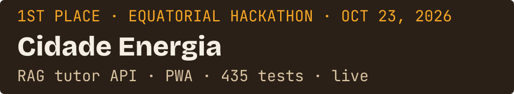
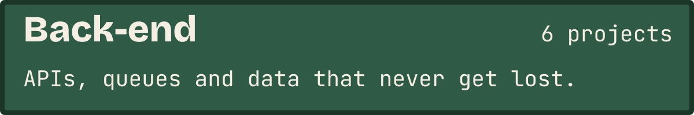
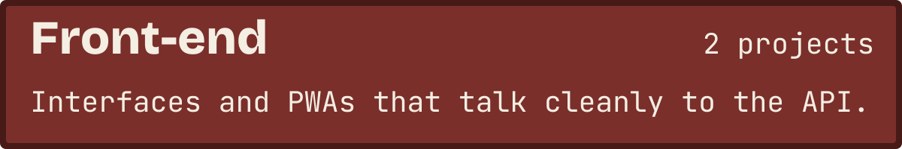
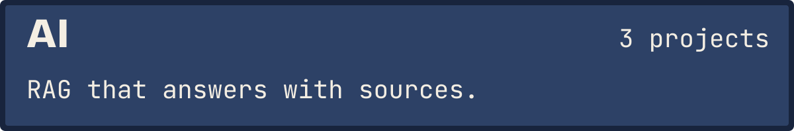

<a href="README.pt-BR.md">Português</a>

<a href="https://portfolio-next-flax-seven.vercel.app"><picture><source media="(prefers-color-scheme: dark)" srcset="assets/cover-en-dark.svg"></picture></a>

<a href="#work"><picture><source media="(prefers-color-scheme: dark)" srcset="assets/nav-work-en-dark.svg"></picture></a><a href="#skills"><picture><source media="(prefers-color-scheme: dark)" srcset="assets/nav-skills-en-dark.svg"></picture></a><a href="#contact"><picture><source media="(prefers-color-scheme: dark)" srcset="assets/nav-contact-en-dark.svg"></picture></a>

Full-stack developer, back-end focused. I study Science and Technology at UFMA and build REST APIs, queue-based services with RabbitMQ and Redis, and RAG search on PostgreSQL with pgvector: 435 automated tests in Cidade Energia, 94 in AuthGuard.

## Work

<a href="https://cidade-energia.vercel.app">App</a> · <a href="https://cidade-energia-back-end.vercel.app/api/docs">API docs</a> · <a href="https://github.com/Coelho-G-Dev/Cidade-Energia-Back-End">Back-end</a> · <a href="https://github.com/Coelho-G-Dev/Cidade-Energia-Front-End">Front-end</a>

Built with Alcides Casemiro and Gabriel Rodrigues.

<picture></picture>

<ul>
<li><strong>Cidade Energia</strong>: Serverless API on Next.js and Supabase: 22 routes validated with Zod, RLS on every table, 302 tests. <a href="https://github.com/Coelho-G-Dev/Cidade-Energia-Back-End">Repository</a> · <a href="https://portfolio-next-flax-seven.vercel.app/#porta-backend">in the portfolio</a></li>
<li><strong>AuthGuard</strong>: Identity and permissions service: 1,400 req/s, p99 under 35 ms, RabbitMQ with a DLQ, 94 tests. <a href="https://github.com/Coelho-G-Dev/authguard">Repository</a> · <a href="https://portfolio-next-flax-seven.vercel.app/#porta-backend">in the portfolio</a></li>
<li><strong>Guia Maranhão</strong>: Public services API for Maranhão: IBGE and Google Maps data in one place, with JWT auth. <a href="https://github.com/Coelho-G-Dev/Guia-Maranhao">Repository</a> · <a href="https://portfolio-next-flax-seven.vercel.app/#porta-backend">in the portfolio</a></li>
<li><strong>BuscaSUS</strong>: Finds the nearest public health unit and maps the route, with a MongoDB 2dsphere index. <a href="https://github.com/Coelho-G-Dev/Desafio-05-Back-End">Repository</a> · <a href="https://portfolio-next-flax-seven.vercel.app/#porta-backend">in the portfolio</a></li>
<li><strong>RAG Serviços Públicos</strong>: Two decoupled services: FastAPI runs the RAG and a Node.js service filters metadata, with the vectors in the same PostgreSQL. <a href="https://github.com/Coelho-G-Dev/rag-servicos-publicos">Repository</a> · <a href="https://portfolio-next-flax-seven.vercel.app/#porta-backend">in the portfolio</a></li>
<li><strong>API Financeira Inteligente</strong>: ACID transactions on a PostgreSQL ledger, with AI-assisted auditing. <a href="https://github.com/Coelho-G-Dev/api-financeira-inteligente">Repository</a> · <a href="https://portfolio-next-flax-seven.vercel.app/#porta-backend">in the portfolio</a></li>
</ul>

<picture></picture>

<ul>
<li><strong>Cidade Energia</strong>: Next.js 16 and React 19 PWA: solar simulator, quiz tracks, map and tutor. 133 tests, and a mock mode that runs without a back end. <a href="https://github.com/Coelho-G-Dev/Cidade-Energia-Front-End">Repository</a> · <a href="https://portfolio-next-flax-seven.vercel.app/#porta-frontend">in the portfolio</a></li>
<li><strong>BuscaSUS</strong>: Mobile-first map interface: health units by radius and routes with Google Maps. <a href="https://github.com/Coelho-G-Dev/Busca-Sus/tree/main/frontend">Repository</a> · <a href="https://portfolio-next-flax-seven.vercel.app/#porta-frontend">in the portfolio</a></li>
</ul>

<picture></picture>

<ul>
<li><strong>RAG Serviços Públicos</strong>: Answers about public services that cite the source: HNSW vector search under 15 ms on 384d local embeddings. <a href="https://github.com/Coelho-G-Dev/rag-servicos-publicos">Repository</a> · <a href="https://portfolio-next-flax-seven.vercel.app/#porta-ia">in the portfolio</a></li>
<li><strong>API Financeira Inteligente</strong>: Gemini flags anomalies off the posting path, without delaying any transaction. <a href="https://github.com/Coelho-G-Dev/api-financeira-inteligente">Repository</a> · <a href="https://portfolio-next-flax-seven.vercel.app/#porta-ia">in the portfolio</a></li>
<li><strong>Cidade Energia</strong>: Energinho tutor: RAG with Gemini and pgvector, with a similarity threshold calibrated on real questions. <a href="https://github.com/Coelho-G-Dev/Cidade-Energia-Back-End">Repository</a> · <a href="https://portfolio-next-flax-seven.vercel.app/#porta-ia">in the portfolio</a></li>
</ul>

## Skills

<ul>
<li><strong>Back-end:</strong> Node.js · TypeScript · Python and FastAPI</li>
<li><strong>Front-end:</strong> Next.js 16 and React 19 · React and maps · Accessibility · Mock mode</li>
<li><strong>Messaging and caching:</strong> RabbitMQ · Redis</li>
<li><strong>Databases and vector search:</strong> PostgreSQL · pgvector · Supabase · Prisma</li>
<li><strong>Testing and delivery:</strong> Vitest and Jest · Playwright · Docker and Compose · GitHub Actions</li>
</ul>

<a href="https://portfolio-next-flax-seven.vercel.app/#sobre">Where each one shows up</a>

## My year in tiles

<picture><source media="(prefers-color-scheme: dark)" srcset="https://raw.githubusercontent.com/Coelho-G-Dev/Coelho-G-Dev/output/activity-en-dark.svg"></picture>

Each tile is a week of commits on GitHub.

## Contact

<a href="https://portfolio-next-flax-seven.vercel.app">Portfolio</a> · <a href="https://www.linkedin.com/in/gabriel-coelho-7184a32a3">LinkedIn</a> · <a href="mailto:gabrielbiellosousa@gmail.com">Email</a>

