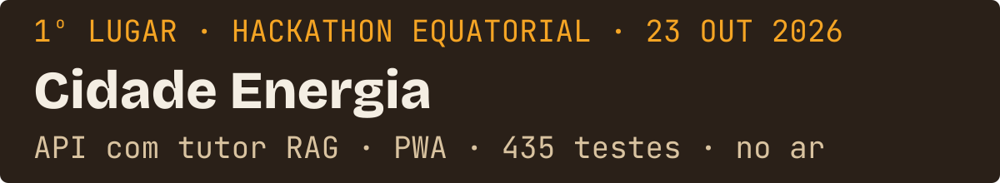
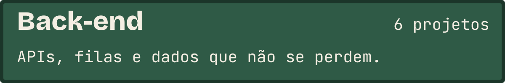
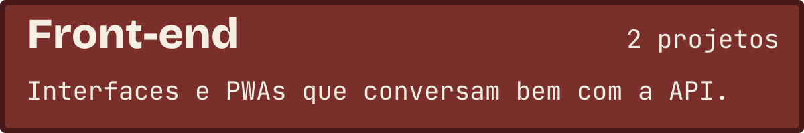
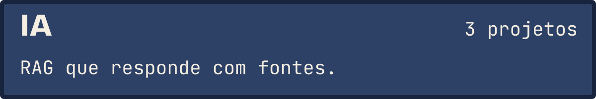

<a href="https://github.com/Coelho-G-Dev">English</a>

<a href="https://portfolio-next-flax-seven.vercel.app"><picture><source media="(prefers-color-scheme: dark)" srcset="assets/cover-pt-dark.svg"></picture></a>

<a href="#projetos"><picture><source media="(prefers-color-scheme: dark)" srcset="assets/nav-work-pt-dark.svg"></picture></a><a href="#skills"><picture><source media="(prefers-color-scheme: dark)" srcset="assets/nav-skills-pt-dark.svg"></picture></a><a href="#contato"><picture><source media="(prefers-color-scheme: dark)" srcset="assets/nav-contact-pt-dark.svg"></picture></a>

Desenvolvedor full-stack com foco em back-end. Curso Ciência e Tecnologia na UFMA e construo APIs REST, serviços com filas em RabbitMQ e Redis e busca RAG em PostgreSQL com pgvector: 435 testes automatizados no Cidade Energia, 94 no AuthGuard.

## Projetos

<a href="https://cidade-energia.vercel.app">App</a> · <a href="https://cidade-energia-back-end.vercel.app/api/docs">Docs da API</a> · <a href="https://github.com/Coelho-G-Dev/Cidade-Energia-Back-End">Back-end</a> · <a href="https://github.com/Coelho-G-Dev/Cidade-Energia-Front-End">Front-end</a>

Feito com Alcides Casemiro e Gabriel Rodrigues.

<picture></picture>

<ul>
<li><strong>Cidade Energia</strong>: API serverless em Next.js e Supabase: 22 rotas validadas com Zod, RLS em todas as tabelas, 302 testes. <a href="https://github.com/Coelho-G-Dev/Cidade-Energia-Back-End">Repositório</a> · <a href="https://portfolio-next-flax-seven.vercel.app/#porta-backend">no portfólio</a></li>
<li><strong>AuthGuard</strong>: Serviço de identidade e permissões: 1.400 req/s, p99 abaixo de 35 ms, RabbitMQ com DLQ, 94 testes. <a href="https://github.com/Coelho-G-Dev/authguard">Repositório</a> · <a href="https://portfolio-next-flax-seven.vercel.app/#porta-backend">no portfólio</a></li>
<li><strong>Guia Maranhão</strong>: API de serviços públicos do Maranhão: dados do IBGE e do Google Maps num só lugar, com JWT. <a href="https://github.com/Coelho-G-Dev/Guia-Maranhao">Repositório</a> · <a href="https://portfolio-next-flax-seven.vercel.app/#porta-backend">no portfólio</a></li>
<li><strong>BuscaSUS</strong>: Encontra a unidade de saúde pública mais próxima e traça a rota, com índice 2dsphere no MongoDB. <a href="https://github.com/Coelho-G-Dev/Desafio-05-Back-End">Repositório</a> · <a href="https://portfolio-next-flax-seven.vercel.app/#porta-backend">no portfólio</a></li>
<li><strong>RAG Serviços Públicos</strong>: Dois serviços desacoplados: FastAPI orquestra o RAG e um serviço Node.js filtra metadados, com os vetores no mesmo PostgreSQL. <a href="https://github.com/Coelho-G-Dev/rag-servicos-publicos">Repositório</a> · <a href="https://portfolio-next-flax-seven.vercel.app/#porta-backend">no portfólio</a></li>
<li><strong>API Financeira Inteligente</strong>: Transações ACID num ledger em PostgreSQL, com auditoria assistida por IA. <a href="https://github.com/Coelho-G-Dev/api-financeira-inteligente">Repositório</a> · <a href="https://portfolio-next-flax-seven.vercel.app/#porta-backend">no portfólio</a></li>
</ul>

<picture></picture>

<ul>
<li><strong>Cidade Energia</strong>: PWA em Next.js 16 e React 19: simulador solar, trilhas com quiz, mapa e tutor. 133 testes e um modo simulado que roda sem back-end. <a href="https://github.com/Coelho-G-Dev/Cidade-Energia-Front-End">Repositório</a> · <a href="https://portfolio-next-flax-seven.vercel.app/#porta-frontend">no portfólio</a></li>
<li><strong>BuscaSUS</strong>: Interface de mapa mobile-first: unidades de saúde por raio e rotas com o Google Maps. <a href="https://github.com/Coelho-G-Dev/Busca-Sus/tree/main/frontend">Repositório</a> · <a href="https://portfolio-next-flax-seven.vercel.app/#porta-frontend">no portfólio</a></li>
</ul>

<picture></picture>

<ul>
<li><strong>RAG Serviços Públicos</strong>: Respostas sobre serviços públicos que citam a fonte: busca vetorial HNSW abaixo de 15 ms com embeddings locais de 384d. <a href="https://github.com/Coelho-G-Dev/rag-servicos-publicos">Repositório</a> · <a href="https://portfolio-next-flax-seven.vercel.app/#porta-ia">no portfólio</a></li>
<li><strong>API Financeira Inteligente</strong>: O Gemini aponta anomalias fora do caminho do lançamento, sem atrasar nenhuma transação. <a href="https://github.com/Coelho-G-Dev/api-financeira-inteligente">Repositório</a> · <a href="https://portfolio-next-flax-seven.vercel.app/#porta-ia">no portfólio</a></li>
<li><strong>Cidade Energia</strong>: Tutor Energinho: RAG com Gemini e pgvector, com limiar de similaridade calibrado com perguntas reais. <a href="https://github.com/Coelho-G-Dev/Cidade-Energia-Back-End">Repositório</a> · <a href="https://portfolio-next-flax-seven.vercel.app/#porta-ia">no portfólio</a></li>
</ul>

## Skills

<ul>
<li><strong>Back-end:</strong> Node.js · TypeScript · Python e FastAPI</li>
<li><strong>Front-end:</strong> Next.js 16 e React 19 · React e mapas · Acessibilidade · Modo simulado</li>
<li><strong>Mensageria e cache:</strong> RabbitMQ · Redis</li>
<li><strong>Bancos e busca vetorial:</strong> PostgreSQL · pgvector · Supabase · Prisma</li>
<li><strong>Testes e entrega:</strong> Vitest e Jest · Playwright · Docker e Compose · GitHub Actions</li>
</ul>

<a href="https://portfolio-next-flax-seven.vercel.app/#sobre">Onde cada uma aparece</a>

## Meu ano em azulejos

<picture><source media="(prefers-color-scheme: dark)" srcset="https://raw.githubusercontent.com/Coelho-G-Dev/Coelho-G-Dev/output/activity-pt-dark.svg"></picture>

Cada azulejo é uma semana de commits no GitHub.

## Contato

<a href="https://portfolio-next-flax-seven.vercel.app">Portfólio</a> · <a href="https://www.linkedin.com/in/gabriel-coelho-7184a32a3">LinkedIn</a> · <a href="mailto:gabrielbiellosousa@gmail.com">E-mail</a>

